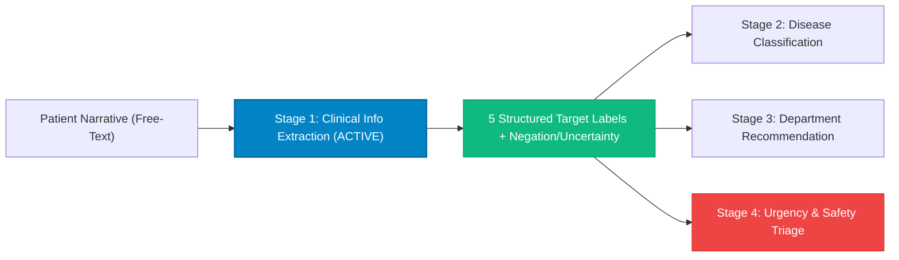

# Clinical Triage NLP — Stage 1 Information Extractor

A clinical-grade NLP extraction engine and modern web interface tailored for **Stage 1 of the Clinical Triage Decision Support Pipeline**.

This project focuses on extracting the **5 core target clinical labels** while preserving **negation** ("no fever") and **uncertainty** ("possibly dizzy") attributes with strict, uncorrupted modifier binding.

---

## 🎯 Target Schema: The 5 Core Labels

| # | Target Label            | Example Extracted Value                | Clinical Triage Rationale                                                          |
| - | ----------------------- | -------------------------------------- | ---------------------------------------------------------------------------------- |
| 1 | `SYMPTOMS`            | *Headache, fever, dizziness*         | Identifies confirmed clinical phenomena while isolating negated/uncertain findings |
| 2 | `BODY_LOCATION`       | *Head, chest, abdomen, eyes*         | Distinguishes complaints by anatomical region to route to appropriate specialists  |
| 3 | `DURATION_ONSET`      | *Three days; started this morning*   | Captures acuity, chronicity, and symptom duration timestamps                       |
| 4 | `SEVERITY`            | *Mild, moderate, severe, unknown*    | Measures symptom intensity without inventing severities for unrated symptoms       |
| 5 | `ASSOCIATED_SYMPTOMS` | *Headache with nausea and dizziness* | Captures syndromic combinations that impact clinical urgency and red flags         |

---

## 🛡️ Critical Clinical Assertion Rules

1. **Negation Preservation (ConText / NegEx Clinical Logic)**:
   - *"No fever"* or *"denies chest pain"* must **never** be classified as confirmed positive symptoms.
   - Identified and isolated under `negated_symptoms` with an explicit `assertion: "negated"` attribute tag and negation trigger mapping.
2. **Uncertainty & Speculation Preservation**:
   - *"Possibly experiencing dizziness"* or *"unclear if nauseous"* must **never** be treated as confirmed symptoms.
   - Preserved under `uncertain_symptoms` with `certainty: "uncertain"` and uncertainty trigger mapping.
3. **Strict Attribute Binding (No Hallucinated Modifiers)**:
   - In *"I've had a severe headache for three days, and since this morning I've been experiencing nausea and blurred vision."*:
     - `headache` &rarr; Severity: `"severe"`, Duration: `"3 days"`
     - `nausea` &rarr; Severity: `"unknown"`, Duration: `"unknown"`
     - `blurred vision` &rarr; Severity: `"unknown"`, Duration: `"since this morning"`
     - `body_location` &rarr; `["head", "eyes"]`
     - `associated_symptoms` &rarr; `["headache with nausea", "headache with blurred vision"]`

---

## 🏥 Decoupled Clinical Pipeline Architecture



### Why Decoupling is Vital for Patient Safety:

Predicting a disease does **not** automatically establish which department a patient should visit or how urgently they need care:

- Headache and nausea alone cannot confirm a specific diagnosis.
- However, **severe headache accompanied by new acute blurred vision** triggers an urgent red flag safety evaluation. A safety layer must never allow an ordinary disease classifier to dismiss concerning symptoms.

---

## 🚀 Quickstart & Running the Application

### 1. Unified Backend + Web UI (FastAPI)

The backend serves both the REST API and the compiled React production frontend on **port 8050**:

```bash
# Activate virtual environment
source .venv/bin/activate

# Start server
uvicorn backend.main:app --host 0.0.0.0 --port 8050 --reload
```

Open **[http://localhost:8050](http://localhost:8050)** in your browser.

### 2. Frontend Development Server (Vite Hot-Reload)

For active UI development with instant hot-module replacement on **port 5173**:

```bash
cd frontend
npm run dev
```

Open **[http://localhost:5173](http://localhost:5173)** in your browser (proxies API requests to port 8050).

---

## 📡 REST API Reference

### `POST /api/extract`

Extracts structured clinical labels from free-text:

```bash
curl -X POST http://localhost:8050/api/extract \
  -H "Content-Type: application/json" \
  -d '{"text": "I'\''ve had a severe headache for three days, and since this morning I'\''ve been experiencing nausea and blurred vision."}'
```

**Response Format:**

```json
{
  "symptoms": ["headache", "nausea", "blurred vision"],
  "negated_symptoms": [],
  "uncertain_symptoms": [],
  "body_location": ["head", "eyes"],
  "duration_onset": {
    "headache": "3 days",
    "nausea": "unknown",
    "blurred vision": "since this morning"
  },
  "severity": {
    "headache": "severe",
    "nausea": "unknown",
    "blurred vision": "unknown"
  },
  "associated_symptoms": [
    "headache with nausea",
    "headache with blurred vision"
  ],
  "entities": [...],
  "spans": [...],
  "clinical_summary": "Patient presents with confirmed affirmed findings: headache, nausea, blurred vision.",
  "downstream_readiness": {
    "stage_1_extraction_complete": true,
    "stage_2_disease_classification_ready": true,
    "stage_3_department_routing_ready": true,
    "stage_4_urgency_assessment_ready": true,
    "red_flag_alert": true
  }
}
```

### `GET /api/presets`

Returns clinical benchmark scenarios (Neurology, Cardiac with NegEx, Pediatric Fever, Acute Abdomen, Transient Neuro).

### `GET /api/health`

Health check endpoint.
# nlp-p
