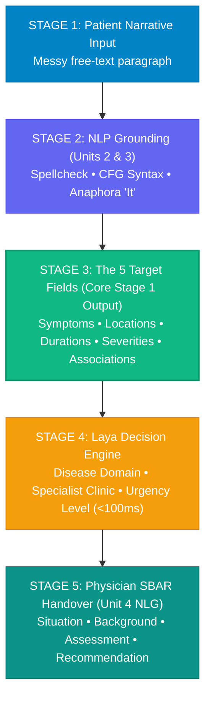

# 🩺 Clinical Triage NLP System — Simple Guide (`README_UP.md`)

> **Everything you need to understand, explain, and demonstrate this project simply.**  
> Built for the University Natural Language Processing Course (**23CS7PENLP / 23CS8PENLP**).

---

## 💡 1. What is this project in 30 seconds?

When patients describe their health online or at an emergency desk, they type messy, conversational paragraphs:
> *"I've had a severe headache for three days, and since this morning I've been experiencing nausea and blurred vision."*

Our system takes that messy narrative and runs it through a **5-stage sequential NLP pipeline**:
1. **Linguistic NLP Grounding**: Fixes typos with Levenshtein dynamic programming, tags parts of speech, parses sentence grammar, and resolves pronouns (*"it"*).
2. **5-Field Structured Extraction**: Extracts **Symptoms**, **Body Locations**, **Durations**, **Severities**, and **Syndromic Combinations**—without hallucinating unstated information and respecting negations (*"no fever"*).
3. **Laya Decision Engine**: Classifies the disease, picks the hospital clinic, and flags emergency urgency in **<100ms** on CPU.
4. **Physician SBAR Handover**: Automatically writes a professional medical handover report for the attending doctor.

---

## 🚨 2. What Problem Are We Solving? (Why Traditional AI Fails)

### Problem A: Monolithic Generative LLMs (e.g. GPT-4, Llama)
- **Hallucinating Modifiers**: If a patient says *"I have nausea"*, generic LLMs often invent a severity like *"moderate nausea"*. Our system strictly marks it as `"unknown"`.
- **Dangerous Conflation of Disease & Urgency**: A generic model predicting a common migraine might dismiss the acute red flag of **new sudden blurred vision**. Our system decouples symptom extraction from urgency assessment so critical safety rules never get ignored.
- **Latency & Cost**: LLMs take 2–8 seconds per prompt and require expensive GPUs. Our system runs in **<100ms on a normal laptop CPU**.

### Problem B: Legacy Medical Classifiers (e.g. HUMADEX, BioBERT)
- **Attribute Blindness**: They can tag words as `PROBLEM`, but they **cannot tell which duration or severity belongs to which symptom**.
- **Negation Failure**: In *"denies fever"*, older systems still flag *"fever"* as an active illness. Our system places it in a dedicated *"Pertinent Negatives"* list so healthy patients aren't misdiagnosed.

---

## 🎯 3. The 5 Target Clinical Labels (The Core Schema)

| # | Target Field | Example Extracted Value | Why It Matters Clinically |
|---|---|---|---|
| **1** | `SYMPTOMS` | `["headache", "nausea", "blurred vision"]` | Lists active confirmed complaints. **Negations** (*"no fever"*) and **Uncertainties** (*"possibly dizzy"*) are separated. |
| **2** | `BODY_LOCATION` | `["head", "eyes"]` | Anatomical mapping to direct hospital clinic routing. |
| **3** | `DURATION_ONSET` | `{"headache": "3 days", "blurred vision": "since this morning"}` | Maps exact timeline per symptom (e.g., nausea duration is `"unknown"`). |
| **4** | `SEVERITY` | `{"headache": "severe", "nausea": "unknown"}` | Measures reported intensity **without inventing numbers for unrated symptoms**. |
| **5** | `ASSOCIATED_SYMPTOMS` | `["headache with nausea", "headache with blurred vision"]` | Captures symptom pairs that trigger clinical emergency rules. |

---

## 🪜 4. The 5 Sequential Pipeline Stages Explained



### Stage 1: Patient Narrative Input
- Patient enters natural complaint text into the UI or selects from 5 quick benchmark chips.

### Stage 2: Linguistic NLP Grounding (Syllabus Units 2 & 3)
Before extracting clinical entities, the narrative is cleaned and analyzed:
1. **Levenshtein Spellcheck (Unit 2)**: Detects typos like `"headeche"` or `"nauesa"` using a dynamic programming cost matrix and corrects them with exact edit distance accounting.
2. **WordNet Lemmatization (Unit 2)**: Morphologically parses verbs (e.g., `"started"` $\rightarrow$ root `"start"`) so grammatical past tenses are never corrupted by the spellchecker.
3. **POS Tagging & CFG Chunker (Unit 2)**: Penn Treebank tags (`JJ` Adjective/Severity, `NN` Noun/Symptom, `IN` Preposition) and extracts noun phrases (`a severe headache`) and prepositional phrases (`for three days`).
4. **Anaphora Resolution (Unit 3)**: Hobbs recency algorithm finds pronouns like `"it"` in cross-sentence descriptions (*"I have severe chest pain. It started three hours ago."*) and links the onset back to `"chest pain"`.

### Stage 3: Core Extraction of the 5 Target Fields
- Employs an open-vocabulary clinical matcher with ConText/NegEx assertion scoping.
- **Strict binding**: Modifiers are only attached to the symptom they govern.
- **Negation preservation**: *"no fever"* stays negated; never becomes positive.

### Stage 4: Laya System 1 Decision Engine
- **What is Laya?** It is a non-autoregressive, calibrated decision model that runs a direct forward pass instead of generating tokens sequentially.
- Outputs in **<100ms**:
  - **Predicted Clinical Domain**: e.g., *Neurological / Cerebrovascular* (with calibrated confidence).
  - **Recommended Department**: e.g., *Neurology Clinic*.
  - **Urgency Assessment**: e.g., *Emergency (Immediate Care)*.

### Stage 5: SBAR Handover Note (Unit 4 NLG)
- Synthesizes findings using a 3-tier NLG architecture:
  - **[S] Situation**: Chief presenting complaint.
  - **[B] Background**: Onset timeline and syndromic co-occurrence.
  - **[A] Assessment**: Severity ratings and explicitly confirmed pertinent negatives (*"Patient denies fever"*).
  - **[R] Recommendation**: Suggested hospital unit and safety priority.

---

## 🎓 5. Cheat Sheet for Presentations & Viva (NLP Syllabus Mapping)

When asked **"What genuine NLP concepts are used in this project?"**, use this table:

| Syllabus Topic | Where is it in our code? | What does it do? |
|---|---|---|
| **Unit 2: Word-Level Analysis & Edit Distance** | [`spell_checker.py`](file:///Users/raja/Desktop/nlp-doc/backend/nlp_engine/spell_checker.py) | Dynamic programming matrix for Levenshtein and Damerau transposition distance. Corrects medical typos (`sever` $\rightarrow$ `severe`, distance 1). |
| **Unit 2: Morphological Parsing** | [`spell_checker.py`](file:///Users/raja/Desktop/nlp-doc/backend/nlp_engine/spell_checker.py) | WordNet Lemmatizer parses inflectional suffixes (`-ed`, `-ing`, `-s`) to preserve valid English words. |
| **Unit 2: Syntactic Analysis & POS Tagging** | [`pos_tagger.py`](file:///Users/raja/Desktop/nlp-doc/backend/nlp_engine/pos_tagger.py) | Penn Treebank tagger identifying adjectives (severity), nouns (symptoms), and prepositions (durations). |
| **Unit 2: Context-Free Grammar (CFG)** | [`pos_tagger.py`](file:///Users/raja/Desktop/nlp-doc/backend/nlp_engine/pos_tagger.py) | Production rules ($\text{NP} \rightarrow \text{Det? Adj* Noun+}$, $\text{PP} \rightarrow \text{Prep NP}$) parsing clinical constituent phrases. |
| **Unit 3: Discourse & Reference Resolution** | [`reference_resolver.py`](file:///Users/raja/Desktop/nlp-doc/backend/nlp_engine/reference_resolver.py) | Hobbs-inspired recency salience algorithm resolving cross-sentence pronouns (*"It"* $\rightarrow$ *"chest pain"*). |
| **Unit 4: Natural Language Generation (NLG)** | [`nlg_generator.py`](file:///Users/raja/Desktop/nlp-doc/backend/nlp_engine/nlg_generator.py) | 3-stage NLG pipeline (Content Determination $\rightarrow$ Sentence Aggregation $\rightarrow$ Surface Realization) generating clinical SBAR handovers. |
| **Unit 5: Lexical Resources & Information Extraction** | [`lexicons.py`](file:///Users/raja/Desktop/nlp-doc/backend/nlp_engine/lexicons.py) & [`extractor.py`](file:///Users/raja/Desktop/nlp-doc/backend/nlp_engine/extractor.py) | Open-vocabulary medical ontology & structured 5-field information extraction. |

---

## ⚡ 6. How to Run the Project

### Prerequisites
- Python 3.12 in `.venv312`
- Node.js (v18+)

### Step 1: Start the Backend Server
```bash
# In the project root directory
.venv312/bin/uvicorn backend.main:app --host 0.0.0.0 --port 8050
```

### Step 2: Open in Browser
Visit **`http://localhost:8050`**

*(The backend automatically serves the compiled, production-ready React frontend from `frontend/dist/`)*.

---

## 🧪 7. The 3 Best Test Cases to Demo Live

### Demo 1: The Benchmark Case (Strict Attribute Binding)
- **Input**:
  > *"I've had a severe headache for three days, and since this morning I've been experiencing nausea and blurred vision."*
- **What to point out**:
  - `headache` has severity `"severe"` and duration `"3 days"`.
  - `nausea` duration and severity are strictly `"unknown"` (no hallucinated values!).
  - `blurred vision` has duration `"since this morning"`.
  - Laya flags this as **Emergency** due to acute neurological warning signs.

### Demo 2: Negation & Pertinent Negatives (Patient Safety)
- **Input**:
  > *"Patient presents with severe substernal chest pain for 2 hours. Denies fever, no shortness of breath, and no cough. Possibly experiencing dizziness."*
- **What to point out**:
  - `fever`, `shortness of breath`, and `cough` are extracted as **negated**, not active illnesses.
  - `dizziness` is captured as **uncertain**, keeping the affirmed list pure.
  - Laya routes directly to **Cardiology / Emergency**.

### Demo 3: Typo Correction & NLP Pipeline (Unit 2 & 3)
- **Input**:
  > *"I have sever headeche and nauesa for 2 days. Feeling dizzines and blury vision since morning. Denies feever."*
- **What to point out**:
  - Shows Stage 2 fixing 6 typos via Levenshtein DP:
    `sever` $\rightarrow$ `severe`, `headeche` $\rightarrow$ `headache`, `nauesa` $\rightarrow$ `nausea`, `dizzines` $\rightarrow$ `dizziness`, `blury` $\rightarrow$ `blurry`, `feever` $\rightarrow$ `fever`.
  - Core extraction and Laya decision work seamlessly on the normalized output.

---

## 📁 8. Project File Structure

```text
nlp-doc/
├── backend/
│   ├── main.py                     # FastAPI REST API + Static UI serving
│   └── nlp_engine/
│       ├── extractor.py            # Core 5-field clinical extraction engine
│       ├── spell_checker.py        # Unit 2: Levenshtein DP matrix & lemmatizer
│       ├── pos_tagger.py           # Unit 2: POS tagging & CFG syntactic chunker
│       ├── reference_resolver.py   # Unit 3: Discourse anaphora pronoun resolution
│       ├── nlg_generator.py        # Unit 4: SBAR Natural Language Generation
│       ├── laya_service.py         # Laya System 1 routing & classifier
│       ├── lexicons.py             # Open-domain medical knowledge base
│       └── schemas.py              # Pydantic data schemas & contracts
├── frontend/
│   ├── src/
│   │   ├── App.tsx                 # Clean sequential 5-stage UI
│   │   └── types/clinical.ts       # TypeScript interfaces
│   └── dist/                       # Production frontend build
├── design.md                       # Comprehensive theoretical & clinical spec
├── README_UP.md                    # This simple presentation & quickstart guide
└── README.md                       # Standard repository documentation
```

