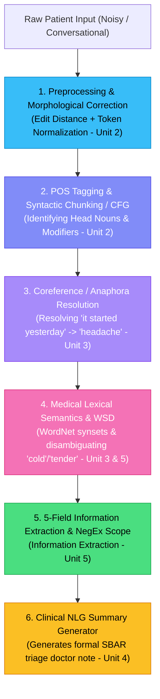

This is a classic critique by university project examiners. If a project is just sending a prompt to an external model/API and displaying the JSON, examiners will say: **"Where is the NLP? You didn't build an NLP system; you built a frontend wrapper around an API."**

Your syllabus (**23CS7PENLP / 23CS8PENLP**) covers the foundational building blocks of computational linguistics. The good news is that **clinical triage is one of the most natural, textbook applications for these exact syllabus concepts**. 

Here is a natural, non-overwhelming brainstorm showing how we can enhance this project from a black-box API caller into a **genuine, syllabus-aligned NLP pipeline**.

---

### The Natural Clinical NLP Pipeline (Syllabus Mapping)

---

### 1. Unit 2: Word-Level & Syntactic Analysis (The Foundation)

#### A. Clinical Spelling Correction & Morphological Normalization (Edit Distance)
* **Real-world clinical problem**: Patients type in distress with typos: *"headeche"*, *"dizzy ness"*, *"vomitting"*, *"sever pain"*, *"abdomin"*.
* **Syllabus Concept**: **Minimum Edit Distance (Levenshtein Distance)** and **Morphological Lemmatization / Stemming**.
* **How it fits**: Before extracting, run an explicit spelling correction layer against a medical vocabulary:
  $$\text{edit\_distance}(\text{"headeche"}, \text{"headache"}) = 1 \implies \text{corrected to "headache"}$$
* **What you can show examiners**: A *"Text Normalization Step"* showing raw tokens $\to$ edit distance suggestions $\to$ corrected clinical tokens.

#### B. POS Tagging & Syntactic Attribute Binding (CFG / Chunking)
* **Real-world clinical problem**: Why is *"severe"* bound to *"headache"* and not *"nausea"* in *"severe headache and nausea"*?
* **Syllabus Concept**: **Part-of-Speech (POS) Tagging** and **Context-Free Grammar (CFG) / Chunking**.
* **How it fits**: 
  - Tag words: `severe/JJ` `headache/NN` `for/IN` `three/CD` `days/NNS`.
  - Define a clinical phrase structure grammar:
    $$\text{SymptomPhrase} \to [\text{Severity: JJ}] + [\text{HeadNoun: NN}] + [\text{Duration: PP}]$$
  - The grammar tree explicitly proves why *"severe"* governs *"headache"*!

---

### 2. Unit 3: Semantic Analysis & Discourse Processing (High Examiner Value!)

#### A. Anaphora / Reference Resolution (Discourse Processing)
* **Real-world clinical problem**: Patients speak in multiple sentences using pronouns:
  > *"I have a sharp pain in my knee. **It** started 3 days ago. **It** is getting worse when walking."*
  
  Legacy systems fail here because the duration *"3 days ago"* is in a sentence that has no symptom name—only the pronoun *"It"*.
* **Syllabus Concept**: **Reference Resolution / Anaphora Resolution** (Unit 3).
* **How it fits**: A rule-based Hobbs-like or recency-based reference resolver:
  $$\text{"It"} \implies \text{antecedent: "sharp pain in knee"}$$
  This allows binding duration (`"3 days"`) to the correct antecedent!

#### B. Word Sense Disambiguation (WSD) & Lexical Semantics
* **Real-world clinical problem**: Polysemy and ambiguous clinical terms:
  - *"I have a bad **cold**"* $\to$ Upper Respiratory Infection (URI).
  - *"My hands feel **cold**"* $\to$ Temperature sensation / Peripheral circulation.
  - *"The doctor said my abdomen is **tender**"* $\to$ Pain upon palpation (NOT soft/gentle).
* **Syllabus Concept**: **Word Sense Disambiguation (WSD)** using the **Simplified Lesk Algorithm** or **WordNet overlap** (Unit 3 & 5).
* **How it fits**: Compute overlap between surrounding context tokens and WordNet definition glosses to pick the correct clinical sense.

---

### 3. Unit 4: Natural Language Generation (NLG)

#### Clinical Triage Report Generator (SBAR / SOAP format)
* **Real-world clinical problem**: Doctors in an Emergency Room don't want to read messy conversational text or raw JSON. They want a standardized **Clinical Handover Note**.
* **Syllabus Concept**: **Architecture of NLG Systems** (Document Planning $\to$ Microplanning $\to$ Surface Realization).
* **How it fits**: The NLG module takes our extracted 5 fields and generates a clean doctor's triage note:
  > **Triage Handover Note:**  
  > *"Patient presents with confirmed acute-onset severe cephalea persisting for 3 days, accompanied by bilateral visual disturbance since this morning. Denies febrile illness. Urgency: Immediate Emergency Neurology Evaluation."*

---

### 4. Unit 4 & Unit 1: Indian Language Support (Local Context)
* **Syllabus Concept**: *"Processing Indian Languages, Translation involving Indian Languages"* (Unit 1 & 4).
* **How it fits**: Add a simple phonetic/transliteration or keyword mapper for Hindi/regional inputs:
  - *"Sir me tez dard hai 3 din se, bukhar nahi hai"*
  - Mapped tokens: `sir dard` $\to$ headache (`severe`), `3 din` $\to$ 3 days, `bukhar nahi` $\to$ `negated: fever`.
  - Examiners in Indian universities **love** seeing an Indian language processing component.

---

### 5. Unit 5: Lexical Resources & Information Extraction

* **Syllabus Concept**: **WordNet Hierarchies** (Hypernyms & Hyponyms) and **Information Extraction**.
* **How it fits**:
  - Use **WordNet** (via `nltk.corpus.wordnet`) to find anatomical and symptom relations:
    - `migraine` is a hyponym of `headache`.
    - `blurred vision` $\to$ anatomical link to `eye` / `vision`.
  - Demonstrates that our Body Location mapping isn't arbitrary—it is backed by WordNet hypernym hierarchies.

---

### Recommended Action Plan: The "Top 4" to Implement First

To make your project stand out academically without becoming unnecessarily complex, we can add:

| Enhancement | Syllabus Unit | What It Does in the UI |
|---|---|---|
| **1. Text Normalizer & Spell Checker** | Unit 2 | Catches patient typos using Levenshtein distance before extraction |
| **2. POS & Syntax Tree Visualizer** | Unit 2 | Shows POS tags (`JJ`, `NN`, `PP`) and how modifiers bind to symptoms |
| **3. Anaphora / Reference Resolver** | Unit 3 | Resolves pronouns (*"it started 2 days ago"*) to the parent symptom |
| **4. SBAR Clinical NLG Generator** | Unit 4 | Automatically synthesizes a formal doctor's handover note from the 5 fields |

How does this sound to you? Which of these would you like to start with, or would you like to build this complete pipeline step-by-step?